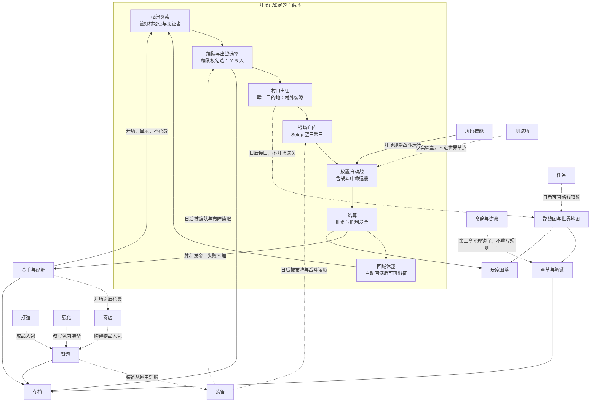

# GDD 功能架构 / Systems Architecture

**项目：** 命运残响 / Echoes of Fate  
**产品：** Steam 第一章 Demo 的完整游戏系统规划（只写文档）  
**引擎 / 视角 / 风格：** Unity 6 LTS + URP 2D；纯 2D 等距；已锁定 Q 版暗黑（见 `docs/art/STYLE_GUIDE.md`）。本文只在系统需要时提及，不重定风格。  
**仓库：** https://github.com/DeanZhang23/my-game1  
**起始 main：** `6234f152b60fc0d6297bcafa75458927d9cf5b0c`（`feat: add M0 TestArena SFX kit (#29)`，父提交为世界地图 squash `66701fd6f11f6f9bf87c2d8b38d0983c23dae192`）  
**文档路径：** `docs/gdd/systems-architecture.md`  
**状态：** 待用户批准后合并，不实现  
**建议日后 PR 标题：** `docs: add systems architecture`

**相关文档（冲突时各管各的范围；本文不改开场循环、战斗规则或世界结构）：**

| 文档 | 作用 |
|---|---|
| `docs/gdd/ch1-grave-lamp-village.md` | 第一章开场枢纽与循环的权威。墓灯村、编队板选人、村门唯一目的地、回村休整、金币只显示不花、未开张摊位以它为准。本文不得改写。 |
| `docs/gdd/world-map.md` | 完整游戏三章世界与遭遇图鉴的权威。地点、范围标记、怪物 ID 与章间连接以它为准。本文不得改写。 |
| `docs/gdd/m0-test-arena-placement.md` | 已锁定的放置自动战与战斗中骰子规则；与 `m0-test-arena.md` 冲突时以该补丁为准。本文不抄公式、不改数值。 |
| `docs/gdd/m0-test-arena.md` | 公式、占位面板、Resolve 与金币发放等仍有效的部分；战前掷骰 / 锁骰 / 重掷 / `TacticalWindow` 已作废，本文不恢复。`system_fate` / `system_defy` 只是预留系统 ID，本文不重写其规则。 |
| `docs/gdd/m0-official-allies-testarena.md` | 正式 8 人与 TestArena 待命规则。编队必须使用其中的仿真单位 ID。 |

本轮只写文档，不实现场景、UI、美术或代码，不合并，不派工，也不开始背包、装备、商店、战斗或其他系统的实现。

---

## 1. 本文是什么 / 不是什么

**是：** 把《命运残响 / Echoes of Fate》作为完整游戏应具备的系统一次规划清楚：每个系统是什么、玩家怎么用、和哪些系统相连、在开场 / 第一章 Demo / 后续章节分别做到哪。给出中文架构图、系统关系、本地化 key，以及日后挂接用的验收接口。

**不是：** 新的战斗规则、公式或单位面板；开场循环的修订；把开场做成商店购买、路线选关、可玩的命途 / 逆命或 Boss 战；第二套布阵规则；把 TestArena 改成村庄；开工票或向美术、UI、特效、音频、工程师派工。不恢复已作废的 Nia Island / 钓鱼 / Abyss Hook 内容，也不引入抽卡、联机或永久死亡。

战斗、骰子与单位数值一律指向已锁定的战斗文档，本文只写系统如何接到它们。默认黄金路径（种子 424242，失败 10.800 秒 / 金币 0）仍是预期，不得为迁就新系统去改黄金文件。

---

## 2. 范围标记：开场已锁定 / 第一章 Demo / 后续章节

每个系统都必须标明范围。一个系统可以同时带两种标记（例如开场只显示金币，第一章 Demo 在开场循环之外才允许花费）。实现时不得把后两类提前塞进开场可玩循环。

| 标记 | 含义 |
|---|---|
| **开场已锁定** | 已写入开场 GDD、战斗补丁或世界地图、并且属于开场可玩循环的部分。本文只引用，不改结论。 |
| **第一章 Demo** | 属于 Steam 第一章 Demo 的产品范围（世界即「墓灯村与近郊裂隙」），但**不是**开场可玩循环。可在开场验收通过之后、不改开场村门 / 摊位 / 战斗的前提下挂接。 |
| **后续章节** | 第二章及以后，或完整游戏需要、但不要求进入第一章 Demo 可玩范围的系统。可在文档中出现，不是开场或立即开工的实现票。 |

**第一章 Demo 的可玩切面（建议，便于收束）：** 开场循环保持已锁定范围；开场之后，Demo 可依次挂上路线地图（只解锁第一章另外三场）、商店开张与金币消耗、背包、基础装备穿脱、轻量任务（只作解锁钩子）、跨进程存档，以及只读图鉴。打造、强化、命途 / 逆命可玩化、数值成长、第二章 / 第三章与两阶段 Boss 放入后续章节，以免核心膨胀。

---

## 3. 一句话与系统总图

一句话：玩家在枢纽编队、出征、在裂隙战场摆阵并进入已锁定的放置自动战，结算后回城休整；金币由胜利结算进入档案，日后才能在商店花出，并经背包落到装备；路线、任务与章节决定能去哪，但不能改写已锁定的开场村门。

下图是系统与关系，不是类图，也不是引擎目录图。实线是开场已锁定的主循环与已确定的数据流向；虚线是第一章 Demo（开场之外）或后续章节才接通的关系。

---

## 4. 系统关系总述

- **出征是两步，不是一套新布阵。** 村里在 `loc_ch1_roster_board` 从正式 8 人中选出 1–5 人（默认勾选灰烬卫士与裂隙术士）；出征后进入 Setup，已选单位出现在待命，格子先空着，玩家再摆到我方 3×3，然后点 `ui.commit`。`ui.ch1.depart`（村里出发）与 `ui.commit`（战场开始 Countdown）必须是两个不同按钮。
- **开场村门只进一场。** `loc_ch1_gate`（或见证者出征确认）的唯一目的地是 `encounter_ch1_opening_rift`（村外裂隙，临时）。敌人是 `enemy_c1`、`enemy_c2` 上的两名 `unit_placeholder_enemy`（锈蚀步卒）。战场沿用现有 TestArena / Rift Battlefield，不是村庄。
- **金币只由结算进入档案。** 币面在确认后计入本场胜利金币；只有胜利才把该金币加入档案；失败或超时为 0。开场可以看见 `ui.gold`，不能花。日后商店开张，才从档案扣金；购得物进入背包。
- **装备住在背包里。** 打造把成品写入背包，强化改写包内已有装备，玩家在背包里穿脱。编队与布阵日后读取「当前出征名单 + 已穿装备」，但开场与默认黄金路径仍只使用已锁定的单位面板，不加装备修正。
- **任务可以闸日后的路线解锁，但不能重开开场村门。** 启用路线地图后，村门才从「唯一目的地」改挂为地图入口；未启用时仍只进村外裂隙。任务不得把开场改成选关，也不得顺便打开商店购买。
- **命途 / 逆命沿用已有预留 ID，不在本文重写。** 世界地图只把它们当作第三章地理钩子；开场没有入口、没有存储、不是可玩系统。
- **存档记下档案状态，不改休整规则。** 回村自动休整仍然执行：生命回满、护盾清除、`fateEnergy` 与技能能量为 0、骰子周期清除、阵亡单位可再编入；金币与日后的背包、解锁进度则保留。无永久死亡。
- **测试场不是世界节点。** `encounter_m0_test` 只用于实验室，不替换 `encounter_ch1_opening_rift`，也不把 TestArena 换皮成墓灯村。

---

## 5. 各系统说明

下列仿真单位 ID 必须照抄，不要自造 `unit_ashguard` / `unit_riftmage`。灰烬卫士与裂隙术士的美术 ID 是 `ashguard` / `riftmage`，绑定在两个占位单位上。显示名走已有 `unit.*.name`。正式名为：`unit_placeholder_melee`（灰烬卫士 / Ashguard，近战）、`unit_placeholder_caster`（裂隙术士 / Riftmage，远程）、`unit_oathblade`（烬誓剑士，近战）、`unit_chainjudge`（锁链判官，近战）、`unit_lampsister`（墓灯修女，远程）、`unit_misthunter`（雾行猎手，远程）、`unit_boneapostle`（骨匣使徒，远程）、`unit_bloodacolyte`（血契侍从，远程）。

### 5.1 枢纽探索 / 村庄交互（`system_hub`，临时系统 ID）（开场已锁定 + 后续扩展）

**这是什么：** 玩家在章内枢纽停留、查看地点、与必要 NPC 交互的系统。开场枢纽是已有正式名墓灯村 / Grave-Lamp Village（`hub_grave_lamp_village`）。后继枢纽锈灯驿、残响回廊以世界地图为准。

**玩家怎么用：** 进入第一章 Demo 后直接在墓灯村，没有登录墙，也不把测试场当开场。灰盒用键盘 + 鼠标点选热区即可，不必先做可漫游大地图。开场可查看村中空地、金币、与见证者 `npc_ch1_guide`（临时名）交谈、打开编队板、走向村门、查看未开张摊位（只得「尚未开张」）。不能买东西、不能打开路线地图、不能在村里把单位摆进 3×3。

**和哪些系统相连：** 编队板接到编队与出战选择；村门接到出征，日后可改挂路线图；摊位日后接到商店；回城休整把玩家送回当前枢纽；存档记下玩家所在枢纽。

**范围与做到哪：**

- **开场已锁定：** 地点仅 `loc_ch1_square`（村中空地）、`loc_ch1_roster_board`（编队板）、`loc_ch1_gate`（村门）、`loc_ch1_closed_stall`（未开张摊位），外加见证者。不新增开场地点或开场 NPC。
- **第一章 Demo：** 仍以墓灯村为唯一 Demo 枢纽。开场之后若启用商店或路线，必须走已留下的摊位 / 村门接口，不把开场地点表改掉。
- **后续章节：** 锈灯驿 `hub_ch2_rust_lamp_post`、残响回廊 `hub_ch3_echo_cloister` 作为后继落脚点，沿用同一套编队、休整、再出征，不是墓灯村换皮，也不是战场。

### 5.2 编队与出战选择（`system_roster`，临时系统 ID）（开场已锁定）

**这是什么：** 布阵的前半步。决定「谁出征」，不决定格子。权威规则见开场 GDD §7，本文不另起一套。

**玩家怎么用：** 在编队板从正式 8 人中勾选 1–5 人。默认已勾选 `unit_placeholder_melee` 与 `unit_placeholder_caster`。可改选或补到 5 人。0 人不能出征，提示走已有 `ui.ch1.depart.blocked` / `npc.ch1.guide.need_squad`，并可并列于 `ui.formation.illegal`。未入选单位本场不进入 Setup 待命，也不参战。回村后可改编队再出征。

**和哪些系统相连：** 读取正式 8 人名单；向战场布阵提供本场出征名单；日后可读取已穿装备（见 §5.10），开场不读装备。存档可记下上次勾选，但开场缺省仍是默认两人。

**范围与做到哪：**

- **开场已锁定：** 8 人全部可选，上限 5，默认两人，只选人不摆格。
- **第一章 Demo / 后续章节：** 继续同一规则。不按章节把某人从名单里删掉，除非日后另有经批准的解锁规则；当前仓库没有「开场未解锁」规则，本文不发明。

### 5.3 战场布阵（`system_formation`，临时系统 ID）（开场已锁定）

**这是什么：** 布阵的后半步。出征之后，在 Setup 把已选单位放到我方空 3×3。规则与现有 Setup 相同，见战斗补丁与开场 GDD §7.3。不要把摆位缩进村里，也不要与编队板合成一步。

**玩家怎么用：** 进入遭遇后，已选 1–5 人全部出现在待命（`ui.formation.bench`），格子先空着。玩家把他们放到我方 3×3：上限 5、一格一人、空阵不能点 `ui.commit`，Countdown 后不可再改阵。然后进入已锁定的 Countdown（约 3 秒）→ AutoCombat → Resolve。

**和哪些系统相连：** 只接受编队系统给出的出征名单；开场不从背包读物品。日后装备系统若启用，布阵与随后的战斗可读取已穿装备，但不得改变开场两人预设，也不得改黄金文件。放置自动战在 `ui.commit` 之后接管。

**范围与做到哪：**

- **开场已锁定：** 空 3×3、待命、两按钮分离，已是开场与 TestArena 的共同规则。
- **第一章 Demo / 后续章节：** 所有世界遭遇沿用同一套 Setup，不按地图另做布阵法。

### 5.4 放置自动战与战斗中命运骰（只引用，不在本文展开）（开场已锁定）

**这是什么：** 已锁定的核心战斗。站位 / 待机后的自动寻敌、移动与攻击；中途掷命运骰，由队伍 `fateEnergy` 门控；效果按职责自动发放，玩家不把骰子拖到单位上。权威是 `docs/gdd/m0-test-arena-placement.md`；公式、占位面板与金币发放等仍有效部分见 `docs/gdd/m0-test-arena.md`。本文不重述公式、骰面数值、寻敌细则或单位面板。

**玩家怎么用：** 布阵并点 `ui.commit` 之后，战斗自动进行。战前不掷骰、不锁骰、不重掷，无 `TacticalWindow`。战斗不因掷骰暂停；6 秒（或战斗结束）自动确认。近战面落到全部存活我方近战，远程面落到全部存活我方远程，指定英雄面落到该英雄，两人连携落到那两人。裂纹 / 腐蚀在 M0 与开场关闭。开场不把指定英雄或两人连携做成玩家操作。

**和哪些系统相连：** 由布阵进入；技能能量在战斗中按已有规则运转；结算读取本场胜负与金币；回城休整清掉本场战斗资源。日后装备若提供修正，也只能加在开场循环之外的遭遇上，且不得改开场预设与黄金文件。

**范围与做到哪：**

- **开场已锁定：** 开场裂隙完全沿用现有 TestArena 战场与两名锈蚀步卒预设。
- **第一章 Demo / 后续章节：** 其他遭遇同样接到这套战斗，只换遭遇与怪物名单（见世界地图），不另写战斗系统。两阶段 Boss 只作为后续章节世界内容，不是开场或 Demo 实现票。

### 5.5 结算（`system_settlement`，临时系统 ID）（开场已锁定）

**这是什么：** 战斗状态机的 Resolve：判定胜负、结算本场金币、向玩家出示结果，然后返回枢纽。不是新的战斗公式。

**玩家怎么用：** 一方全灭，或 150 秒超时（超时 = 失败），进入结算。看到已有结果文案：`ui.result.victory` / `ui.result.defeat` / `ui.result.timeout`。开场可用 `ui.ch1.return_village` 返回墓灯村；胜利或失败皆回，失败不是 Demo 卡死。返回时先执行休整。

**和哪些系统相连：** 从放置自动战接收 `battle_end`（胜负、时长、本场金币）。胜利才把本场金币加入档案经济；失败或超时为 0。币面规则不改：确认后计入本场胜利金币，且须在 Resolve 前完成确认。图鉴可在结算后标记「已遭遇」。存档在回城后写入较稳妥，避免中途退出重复发金；具体时机见 §5.19，不得改变「只有胜利发金」。

**范围与做到哪：**

- **开场已锁定：** 胜负提示、胜利发金、回村。开场不在结算里发装备或打开商店。
- **第一章 Demo：** 开场之后，结算仍只负责胜负与金币（以及日后的遭遇记录）。掉落若要做，也只在开场循环之外，且物品进背包，不在结算界面直接穿上并改开场数值。
- **后续章节：** 可为本场结果补章节演出，但不另做一套结算法，也不恢复已作废的战前骰结算。

### 5.6 回城休整（`system_rest`，临时系统 ID）（开场已锁定）

**这是什么：** 每次战斗结算并返回枢纽时自动执行的恢复。不必点「休息」建筑，也不必找 NPC 治伤。权威见开场 GDD §8.1。

**玩家怎么用：** 回到墓灯村（日后回到当前章枢纽）时自动完成，并可用已有提示 `ui.ch1.rest_done`（队伍已休整。）。无永久死亡：本场阵亡的我方单位回城后再次可编入，生命为满。

**和哪些系统相连：** 在结算之后、玩家再次编队之前执行。恢复战斗资源，但**不清空**档案金币，也不清掉日后的背包、装备与解锁。编队可立刻再出征。

**范围与做到哪：**

| 项目 | 回城后的状态 |
|---|---|
| 存活单位生命 | 回满 |
| 护盾 | 全部到期清除 |
| 队伍 `fateEnergy` | 重置为 0 |
| 各单位技能能量 | 重置为 0 |
| 本场骰子周期 | 清除（下一场仍按规则最多掷 1 次） |
| 本场阵亡的我方单位 | 重新可编入、可出征，生命为满 |
| 档案金币 | 不清零 |
| 日后的背包 / 装备 / 解锁 | 不清零（开场尚无这些数据） |

- **开场已锁定：** 上表除最后一行外均已锁定。
- **第一章 Demo / 后续章节：** 继续自动休整，不改为手动旅店，也不引入永久死亡。

### 5.7 金币 / 经济（`system_economy`，临时系统 ID）（开场已锁定获得与显示；花费属第一章 Demo）

**这是什么：** 档案金币的获得、显示与日后消耗。获得规则已锁定，本文不改面值或公式。

**玩家怎么用：** 枢纽里始终可见档案金币（复用 `ui.gold`）。开场初始为 0。只有胜利把本场金币累加到档案；回村或再出征不清零。开场没有任何消耗口。

**和哪些系统相连：** 金币由结算写入经济；开场只在枢纽显示。日后商店（以及若存在的打造 / 强化费用）从档案扣金。存档保存当前金币。任务与路线不得在开场用扣金或赏金改变村门行为。

**范围与做到哪：**

- **开场已锁定：** 可获得、可显示、不可花费。同一 Demo 档案 / 同一次游玩过程内累计。
- **第一章 Demo：** 开场循环之外，摊位开张后才出现消耗。不得为了给商店「有钱可花」去改开场发金公式或把失败改为发金。
- **后续章节：** 可增加新的汇入 / 汇出口（例如后继枢纽商店），仍走同一笔档案金币，不另开第二货币。不引入抽卡货币。

### 5.8 商店（`system_shop`，临时系统 ID）（开场仅关闭钩子；购买属第一章 Demo）

**这是什么：** 用档案金币换取物品的枢纽服务。开场不是商店，只留一个可见的关闭钩子。

**玩家怎么用：** 开场在 `loc_ch1_closed_stall` 交互，只看到已有文案 `loc.ch1.closed_stall.body`（摊位尚未开张。）。无货架、无价格、无消耗、无店主 NPC。开场之后若商店开张，玩家在同一摊位（或后继枢纽的对应摊位）浏览、支付、获得物品；物品进入背包，不直接改战斗中的单位面板。

**和哪些系统相连：** 读取并扣除经济中的金币；写出到背包。不直接改编队规则。任务可以日后要求「去买某物」，但不得把开场摊位提前变成可购买，也不得让任务在开场里打开商店界面。

**范围与做到哪：**

- **开场已锁定：** 可见、可交互、尚未开张。保持这一结论。
- **第一章 Demo：** 开场验收之外，可启用摊位接口并上架少量货物（装备或材料）。启用不得改写开场循环：未开启该接口时，交互仍只提示尚未开张。
- **后续章节：** 锈灯驿等后继枢纽可挂商店，不把墓灯村开场摊位改成必须开张。

本系统不在本文列出货价或库存表，以免变成战斗数值或经济数值修订。

### 5.9 背包（`system_inventory`，临时系统 ID）（第一章 Demo）

**这是什么：** 玩家持有物的容器。装备、日后的打造材料与商店购得物都住在这里。开场循环没有背包界面，也不在村里新增背包地点。

**玩家怎么用：** 开场不能打开背包，也不需要。开场之后，玩家可从枢纽打开背包（建议用 UI 入口，不新增开场建筑）：查看、整理、把装备穿上或卸下。不在自动战斗中途打开背包、不丢出消耗品中断寻敌。

**和哪些系统相连：** 商店、打造的产出写入背包；强化读取并写回包内装备；装备穿脱在背包与装备栏之间移动；存档保存背包；编队 / 布阵只读取「已穿上」的装备，不直接翻包。

**范围与做到哪：**

- **开场已锁定：** 不做背包。不要把背包塞进开场验收。
- **第一章 Demo：** 商店或掉落一旦启用，就必须有背包，否则物品无处存放。容量规则日后可定，开场不预支。
- **后续章节：** 继续同一背包，可按需扩展分类，不做拍卖行或玩家交易。

### 5.10 装备（`system_equipment`，临时系统 ID）（第一章 Demo）

**这是什么：** 单位可以穿上、从而在开场循环之外的战斗中被读取的物品。装备实体存放在背包里。

**玩家怎么用：** 在枢纽（非战斗中）把装备穿到正式单位上，或卸回背包。开场 8 人在开场裂隙战中一律使用已锁定面板，不穿装备，不改黄金路径。

**和哪些系统相连：** 来源是商店、日后打造，或开场之外的掉落；强化改已有装备；编队与布阵在日后读取已穿装备。放置自动战的公式本身不改；若装备提供修正，只能作为开场之后遭遇的附加输入，且必须能在「无装备」时精确回到已锁定面板。

**范围与做到哪：**

- **开场已锁定：** 无装备。默认两人、不改阵、种子 424242 的仿真结果仍为失败 10.800 / 金币 0。
- **第一章 Demo：** 可做少件、可穿脱的基础装备，作为商店的主要去处。不在本文给数值，以免改战斗文档。
- **后续章节：** 可扩展部位或套装，仍禁止用装备改写开场预设。

### 5.11 打造（`system_craft`，临时系统 ID）（后续章节）

**这是什么：** 消耗材料（及可能的金币）在枢纽生成装备或材料、并写入背包的生产系统。

**玩家怎么用：** 开场不能打造，村庄也不新增打造建筑。日后在已开张摊位或后继枢纽入口中选择配方、支付材料与费用、获得成品到背包。不在战斗里打造。

**和哪些系统相连：** 读背包材料与经济金币，写回背包。不直接改单位基础面板。任务可日后要求提交打造物，但不得因此打开开场商店或改开场村门。

**范围与做到哪：**

- **开场已锁定：** 无。
- **第一章 Demo：** 建议不做，好让 Demo 经济先走「打赢 → 发金 → 商店 → 背包 → 穿装备」。需要时只留关闭提示 `ui.craft.locked`。
- **后续章节：** 再作为完整生产循环开放。本文不列配方表。

### 5.12 强化（`system_enhance`，临时系统 ID）（后续章节）

**这是什么：** 消耗材料或金币，提升背包中已有装备的系统。强化的是物品，不是直接改写单位 ID 上的锁定面板。

**玩家怎么用：** 开场不能强化。日后在与打造相同的枢纽入口中选择一件包内装备并强化。失败销毁等惩罚不做，以免接近永久损失；也不做抽卡式强化。

**和哪些系统相连：** 读背包与经济，写回同一件装备。战斗只在该装备被穿上、且不处于开场裂隙预设时才读取。

**范围与做到哪：**

- **开场已锁定：** 无。
- **第一章 Demo：** 建议后置，仅可留 `ui.enhance.locked`。
- **后续章节：** 再开放。不在本文给强化数值。

### 5.13 路线图 / 世界地图（`system_route_map`，临时系统 ID）（开场仅接口；可玩选关属第一章 Demo）

**这是什么：** 让玩家在已解锁的世界地点中选择下一场遭遇的界面。世界结构本身以 `docs/gdd/world-map.md` 为准：三章、每章 1 枢纽 + 4 个战斗地点。路线图是界面，不是另一份世界志。

**玩家怎么用：** 开场看不到可玩的路线地图。点村门不会打开选关。开场之后若启用该接口，玩家从村门（或后继枢纽出口）打开路线图，选择已解锁地点再进入对应遭遇的 Setup。未解锁地点只显示锁定提示 `ui.route_map.locked`。

**和哪些系统相连：** 开场村门是预留入口，未启用时目的地仍只能是 `encounter_ch1_opening_rift`。章节与解锁、任务可以决定哪些节点亮起。选中地点后仍走编队已完成 → Setup 布阵 → 放置自动战 → 结算 → 回城。图鉴可从地图查看已记录地点。`encounter_m0_test` 不出现在路线图上。

**范围与做到哪：**

- **开场已锁定：** 只留村门接口，不做选关。
- **第一章 Demo：** 可挂第一章另外三场：`encounter_ch1_rust_lamp_path`（锈蚀灯径）、`encounter_ch1_mist_barrow`（雾蚀荒冢）、`encounter_ch1_rift_seep`（裂隙渗口）。必须走开场留下的村门接口，且不得改开场循环，不得顺带开张商店或放入 Boss。
- **后续章节：** 再纳入第二章、第三章地点与章间连接。残响终庭的两阶段 Boss 仍只是世界内容，不是开场或 Demo 实现票。

### 5.14 章节与解锁（`system_chapter`，临时系统 ID）（开场已锁定第一章入口；其余按世界地图）

**这是什么：** 章、区域与地点如何对玩家开放。区域 ID 与范围标记全部沿用世界地图，不另造一棵章节树。

**玩家怎么用：** 进入 Demo 即处于第一章、墓灯村。开场只能去村外裂隙。日后路线图上，未解锁地点不可进入，可用 `ui.chapter.locked` 或 `ui.route_map.locked`。通往锈灯驿、残响回廊只存在于后续章节。

**和哪些系统相连：** 由路线图呈现；可由任务或指定遭遇的胜利解锁；存档记下已解锁集合。命途 / 逆命只作为第三章地理主题挂钩，不在开场用解锁来开放它们的玩法。

**范围与做到哪：**

- **开场已锁定：** 第一章入口 + 村外裂隙。
- **第一章 Demo：** 另三场近郊地点可在开场之外解锁，仍属第一章区域 `region_ch1_near_rift`。
- **后续章节：** 第二章 `region_ch2_deep_rust_rift`、第三章 `region_ch3_defy_echoes`。

### 5.15 任务（`system_quest`，临时系统 ID）（第一章 Demo）

**这是什么：** 给玩家目标、并在完成后可闸路线解锁或引导其使用已有枢纽接口的系统。它不是第二套出征流程。

**玩家怎么用：** 开场没有任务日志，见证者只做短引导（说明此地、指向编队板与村门，队伍合法时可确认出征），不派正式任务。开场之后，玩家可在枢纽查看任务（建议 UI 入口或仍由见证者转述，不在开场村庄新增必做地点）。领取与交付发生在枢纽，不在 AutoCombat 中途。

**和哪些系统相连：** 可把「完成某场已有遭遇」或「持有某件背包物品」当作完成条件；完成后可解锁路线图上的第一章节点。**明确禁止：** 用任务把开场村门改成选关；用任务在开场打开商店购买；用任务改战斗公式、启用裂纹 / 腐蚀，或把指定英雄骰变成开场操作。

**范围与做到哪：**

- **开场已锁定：** 无正式任务。见证者对话保持开场 GDD 已有文案，不改写成任务系统。
- **第一章 Demo：** 只做少量、可关闭的引导或解锁钩子，服务近郊三场与商店，不做大型任务网。
- **后续章节：** 可按章扩展。不引入悬赏板刷金来绕过「只有胜利发金」。

若日后需要任务板地点，建议临时 ID `loc_ch1_quest_board`（临时），且只能作为第一章 Demo 开场之后的可选挂接，**不是**开场地点，开场验收不得要求它存在。

### 5.16 命途 / 逆命（`system_fate` / `system_defy`，已有预留 ID）（后续章节；开场不可玩）

**这是什么：** 仓库已预留的两套元进度 / 命运主题系统。世界地图把它们作为第三章「逆命残庭」的地理钩子（命途长阶、逆命裂核、残响终庭等）。`m0-test-arena.md` §10 写过只读规则，但其中逆命仍带有已作废的战前改骰 / 锁骰表述。**本文不重写、不修订这些规则，也不把它们做成开场或 Demo 的可玩入口。**

**玩家怎么用：** 开场不能进入、不能存储、看不到可玩界面。日后可玩化按开场 GDD §9，挂在枢纽接口上，并且必须另开专门设计、先与已锁定的「战斗中掷骰、无战前骰」对齐，而不能在本架构里恢复战前改骰。

**和哪些系统相连：** 地理上只与第三章地点和章节解锁相连。可能与存档、元进度相连，但开场存档不为它们留可玩数据入口。不得改放置自动战的开场规则。

**范围与做到哪：**

- **开场已锁定：** 无入口、无存储、不重写。
- **第一章 Demo：** 仍不可玩。若界面需要占位，只用关闭提示 `ui.systems.fate.locked` / `ui.systems.defy.locked`，且开场不得出现这两条入口。
- **后续章节：** 仅保留 ID 与地理钩子；可玩规则不在本文展开，也不是实现票。

### 5.17 角色技能（沿用已有战斗技能，不另开成长树）（开场已锁定运转；成长后置）

**这是什么：** 单位在自动战斗里积累技能能量并释放已有技能的规则，例如 `skill_placeholder_cleave`、`skill_placeholder_bolt`。能量与队伍 `fateEnergy` 分离，权威在战斗文档。本文不把技能改成可点的天赋树，也不做等级经验。

**玩家怎么用：** 开场无需在村里装配技能。出征后技能在 AutoCombat 中按已有规则自动释放。回城时各单位技能能量归 0。

**和哪些系统相连：** 只在放置自动战中运转；休整重置能量；日后装备可以在开场之外提供技能相关修正，但不改已锁定的开场技能面板。

**范围与做到哪：**

- **开场已锁定：** 沿用占位技能与能量，不改数值。
- **第一章 Demo：** 不另做升级、转职或技能商店，以免改黄金文件。
- **后续章节：** 若要扩展技能，必须另写设计，且不得回头改开场两人面板。角色成长优先走装备 / 日后的打造与强化，而不是改基础数值。

### 5.18 玩家图鉴（`system_codex`，临时系统 ID）（第一章 Demo）

**这是什么：** 面向玩家的地点与怪物记录。设计侧的遭遇图鉴已在世界地图 §5；本系统是游戏内只读查阅，不改世界结构，也不把正式 8 人写成野外怪。

**玩家怎么用：** 开场不做图鉴界面。开场之后可从枢纽打开图鉴：已遭遇的地点 / 怪物显示已有名称，未记录的显示 `ui.codex.undiscovered`。不在图鉴里直接选关（选关只走路线图）。

**和哪些系统相连：** 结算与路线图可写入「已见」；名称走已有或世界地图 §6 的 key。测试场遭遇不必写入玩家世界图鉴，以免 `encounter_m0_test` 混入世界节点。

**范围与做到哪：**

- **开场已锁定：** 无。
- **第一章 Demo：** 可做只读图鉴，收录墓灯村、村外裂隙，以及玩家在开场之外实际进入过的近郊地点与怪物。
- **后续章节：** 再收入第二、三章条目。残响寄体条目不得在开场或 Demo 未实装时作为可打目标出现。

### 5.19 存档（`system_save`，临时系统 ID）（开场仅同次游玩累计；跨进程属第一章 Demo）

**这是什么：** 把档案状态保持下来的系统。开场 GDD 已要求同一 Demo 档案 / 同一次游玩过程内累计金币并显示；跨进程存档明确后置，本文补规划，但不改开场循环。进入第一章 Demo 仍没有登录墙。

**玩家怎么用：** 开场不要求手动存盘界面。同一进程里，金币在胜利后保留，再出征不清零。开场之后可在枢纽自动保存，或提供简单的保存 / 继续（`ui.save.saved`）。继续游戏应回到当前枢纽，而不是 TestArena，也不是登录墙。

**和哪些系统相连：** 至少保存：档案金币、所在枢纽、编队勾选、已解锁地点、背包与已穿装备、任务状态、图鉴已见记录。不保存本场未结算战斗的临时生命 / 护盾 / `fateEnergy` / 技能能量作为「带伤再战」——回城休整规则优先，读档后的队伍应按已休整状态出现，除非日后另有经批准的中途战斗存档设计。不得靠读档把失败改成发金，也不得保存已作废的战前骰状态。

**范围与做到哪：**

- **开场已锁定：** 同次游玩内金币累计与显示。不要求关游戏后再读回来。
- **第一章 Demo：** 建议补上跨进程存档，否则商店与背包在 Demo 中难以成立。
- **后续章节：** 同一套档案可延伸到后继章节；不做多人或云交易。槽位数量日后可定。

### 5.20 测试场（已有 `encounter_m0_test`）（实验室保留；不属于开场或世界地图）

**这是什么：** 已有实验室遭遇与场景 `Assets/Scenes/TestArena.unity`，资源 ID `encounter_m0_test`。用于对照放置自动战、待命六人、种子与黄金路径。它**不是**世界地图节点，也不替换开场遭遇 `encounter_ch1_opening_rift`。

**玩家怎么用：** 不是开场入口。Steam 第一章 Demo 的玩家流程从墓灯村开始。开场裂隙只**借用** TestArena 的战场空间与敌人预设，必须保持「战场是 Rift Battlefield，枢纽是墓灯村」这一分开关系。禁止把 TestArena 换皮成墓灯村，也禁止把墓灯村做成裂隙测试场。

**和哪些系统相连：** 只接到放置自动战与正式 8 人的待命规则。默认 March 仍是 `unit_placeholder_melee` 在 `ally_c2`、`unit_placeholder_caster` 在 `ally_a2`，对 `enemy_c1` / `enemy_c2` 上的锈蚀步卒。灰盒可保留种子输入供对照。测试场标题仍用已有 `ui.test_arena.title`，不要把世界地点写成「测试场」。

**范围与做到哪：**

- **开场已锁定：** 开场不把玩家先丢进测试场；开场遭遇另有 ID，只复用战场与敌人预设。
- **第一章 Demo / 后续章节：** 可作为开发对照保留，不进入路线图，不进入玩家世界图鉴的必经节点。

---

## 6. 本地化 key 表

所有玩家可见文案走 key，不要在场景或代码里写死中文。已有 key **全部复用，不改文案、不另造一份同义 key**。

**复用（已在 `M0Localization.asset`、开场 GDD §10 或世界地图 §6）：**

- 战斗与结算：`ui.commit`、`ui.gold`、`ui.result.victory` / `ui.result.defeat` / `ui.result.timeout`、`ui.formation.bench`、`ui.formation.illegal`、`ui.phase.*`
- 开场枢纽：`hub.grave_lamp_village.name`、`loc.ch1.square.name`、`loc.ch1.roster_board.name`、`loc.ch1.gate.name`、`loc.ch1.closed_stall.name`、`loc.ch1.closed_stall.body`、`npc.ch1.guide.*`、`encounter.ch1.opening_rift.name`、`ui.ch1.roster.title`、`ui.ch1.roster.limit`、`ui.ch1.depart`、`ui.ch1.depart.blocked`、`ui.ch1.return_village`、`ui.ch1.rest_done`
- 单位正式名：`unit.placeholder_melee.name`、`unit.placeholder_caster.name`、`unit.oathblade.name`、`unit.chainjudge.name`、`unit.lampsister.name`、`unit.misthunter.name`、`unit.boneapostle.name`、`unit.bloodacolyte.name`、`unit.placeholder_enemy.name`
- 世界地点与新怪物名：世界地图 §6 已列的 `region.*`、`hub.ch2.*`、`hub.ch3.*`、`encounter.ch1.*` / `encounter.ch2.*` / `encounter.ch3.*`、`unit.ch1.*` / `unit.ch2.*` / `unit.ch3.*`
- 测试场标题：`ui.test_arena.title`

`ui.ch1.depart` 与 `ui.commit` 都可显示「出征」，但仍是两个按钮，不要合并。

**本文新增（建议默认简体中文；系统显示名可日后替换，ID / key 保持稳定；标「临时」的系统 ID 见各节）：**

| Key | 建议默认 zh-Hans |
|---|---|
| `ui.inventory.title` | 背包 |
| `ui.inventory.empty` | 背包是空的。 |
| `ui.equipment.title` | 装备 |
| `ui.equipment.unequipped` | 未装备 |
| `ui.craft.title` | 打造 |
| `ui.craft.locked` | 打造尚未开放。 |
| `ui.enhance.title` | 强化 |
| `ui.enhance.locked` | 强化尚未开放。 |
| `ui.shop.title` | 商店 |
| `ui.quest.title` | 任务 |
| `ui.quest.empty` | 暂无任务。 |
| `ui.codex.title` | 图鉴 |
| `ui.codex.undiscovered` | 尚未记录。 |
| `ui.route_map.title` | 路线地图 |
| `ui.route_map.locked` | 这条路尚未开放。 |
| `ui.save.title` | 存档 |
| `ui.save.saved` | 进度已保存。 |
| `ui.chapter.locked` | 该章节尚未开放。 |
| `ui.systems.fate.locked` | 命途尚未开放。 |
| `ui.systems.defy.locked` | 逆命尚未开放。 |

日后若新增物品，显示名建议走 `item.{id}.name`，物品 ID 使用 `item_` 前缀，配方使用 `recipe_` 前缀，且必须避免与已有 `unit_*`、`encounter_*`、`loc_*`、`ui.*`、`system_fate`、`system_defy` 冲突。本文不预先发明物品清单或价格。

---

## 7. 后续实现验收接口（本轮不实现）

本轮只交文档。日后实现可用下列接口核对；灰盒键盘 + 鼠标即可，正式 UI 美术以后再做。不要为赶验收改战斗数值或黄金文件。不要把本列表写成开场商店、开场选关、开场可玩命途 / 逆命、开场 Boss，或背包 / 装备 / 商店的开工票。也不要向美术、UI、特效、音频或工程师派发本轮开工任务。

**开场必须仍然满足（与开场 GDD、世界地图、战斗补丁一致，本文不放松）：**

1. 进入第一章 Demo 后，玩家先在墓灯村，没有登录墙，不把 TestArena 当作村庄，也不把裂隙地皮换皮成村庄。
2. 编队板选出 1–5 人（默认灰烬卫士与裂隙术士）后，村门或见证者出征的唯一目的地仍是 `encounter_ch1_opening_rift`。`ui.ch1.depart` 与 `ui.commit` 仍是两步、两个按钮。
3. Setup 格子先空，已选单位在待命；随后 Countdown → AutoCombat → Resolve 完全按战斗补丁：无战前骰、无锁骰、无重掷、无 `TacticalWindow`，效果自动发放。敌人仍是两名锈蚀步卒。
4. 结算后回村自动休整；胜利金币累加显示，失败不加；摊位只提示尚未开张；看不到可玩路线选关、可玩命途 / 逆命、Boss 或商店购物。
5. 种子 424242、默认两人、不改阵的仿真黄金路径仍为失败 10.800 秒、金币 0。

**完整游戏系统在「开场循环之外」日后挂接时应对齐：**

6. 系统关系与 §3 图、§4 一致：金币只由胜利结算进入档案，再由商店扣除；物品进背包；装备从背包穿脱；编队 / 布阵只在开场之外才读取装备。
7. 路线图若启用，必须走村门留下的接口；未启用时村门仍只进开场裂隙。任务可以闸第一章另外三场的解锁，但不能重开开场村门为选关，也不能顺便让开场摊位变成可购买。
8. 新系统使用本文临时系统 ID 与 §6 新 key；不与已有 ID 冲突；不出现 `unit_ashguard` / `unit_riftmage`；不把 `encounter_m0_test` 写入世界路线图。
9. `system_fate` / `system_defy` 若日后可玩化，必须另写设计并对齐战斗中掷骰，不得在开场出现入口，也不得恢复已作废的战前改骰。
10. 存档若跨进程，读回后应落在枢纽并遵守休整后的战斗资源状态；不得靠存档改开发金规则或改黄金文件。
11. 打造、强化、第二章 / 第三章、两阶段 Boss 不在开场或开场验收中出现。本文列出它们只为完整规划。

---

## 8. 明确不改

- 不改 `docs/gdd/ch1-grave-lamp-village.md` 已锁定的开场循环、村门唯一目的地、默认编队、两步布阵、休整、金币只显示不花、未开张摊位，以及开场不做路线选关、商店购买、可玩命途 / 逆命与 Boss 的结论。
- 不改 `docs/gdd/world-map.md` 的三章结构、地点 ID、范围标记、怪物图鉴与章间连接。
- 不改 `docs/gdd/m0-test-arena-placement.md` 已锁定的放置自动战、寻敌、命运能量、骰子周期与自动发放规则。
- 不改核心公式、骰面数值、双生 / 同调系数、币面只在胜利发金、占位单位战斗面板。
- 不改黄金文件 `tests/Echoes.Simulation.Tests/golden/m0-midcombat-dice.txt`，不把默认黄金路径改成必胜。
- 不启用裂纹 / 腐蚀，不把指定英雄或两人连携做成开场操作，不恢复战前掷骰 / 锁骰 / 重掷 / `TacticalWindow`。
- 不把 TestArena（Rift Battlefield）改成墓灯村，也不把墓灯村做成裂隙测试场。
- 不重写 `system_fate` / `system_defy` 的规则，不把第三章写成这两套系统的实现票。
- 不把正式 8 人改名或改成野外怪，不发明 `unit_ashguard` / `unit_riftmage`。
- 不引入抽卡、联机或永久死亡。
- 不恢复已作废的 Nia Island / 钓鱼 / Abyss Hook 内容。
- 本文不向美术、UI、特效、音频或工程师派发开工任务。

---

## 9. 建议砍掉与后置（保持可交付的核心）

为了让 Steam 第一章 Demo 收得住，下列内容写入完整规划，但建议不要挤进开场，也不要全部塞进 Demo 的第一批可玩扩展：

| 后置项 | 原因 |
|---|---|
| 打造、强化 | Demo 先用商店 + 背包 + 基础穿脱即可形成循环；生产系统可放后续章节。 |
| 经验等级、天赋树、转职 | 容易改锁定面板与黄金文件；成长优先走日后装备。 |
| 命途 / 逆命可玩化 | 已有预留 ID 与第三章地理钩子，但旧规则含作废的战前骰表述，需另写设计。 |
| 第二章 / 第三章与两阶段 Boss | 世界内容已锁定在世界地图，不是开场或 Demo 实现票。 |
| 战斗中使用消耗品、第二货币、拍卖与交易 | 会打断自动战或膨胀经济。 |
| 抽卡、联机、永久死亡 | 与已锁定的单机放置自动战、回城复活冲突。 |
| 正式大界面、完整手柄、Steam 打包细节 | 灰盒键盘 + 鼠标足够验证系统关系。 |
| 暂停 / 设置以外的生活系统（钓鱼、装修等） | 已作废内容不恢复；新生活系统不做。 |
| 裂纹 / 腐蚀的启用 | M0 与开场已关闭，不在本架构里重新打开。 |

开场要做的仍然只是已锁定的那一段：进村、选人、出征打村外裂隙、结算回村休整、看见金币与未开张摊位。
