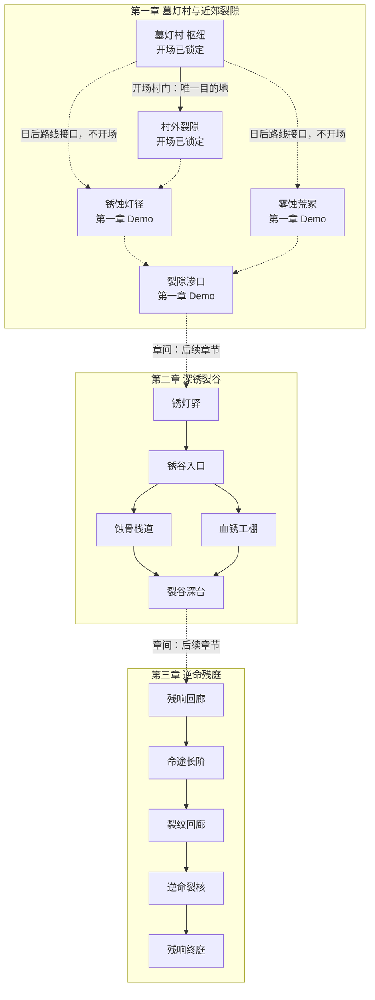

# GDD 世界地图与遭遇图鉴 / World Map and Encounter Bestiary

**项目：** 命运残响 / Echoes of Fate  
**产品：** Steam 第一章 Demo 的世界范围 + 完整游戏后续章节（只写文档）  
**引擎 / 视角 / 风格：** Unity 6 LTS + URP 2D；纯 2D 等距；已锁定 Q 版暗黑（见 `docs/art/STYLE_GUIDE.md`）  
**仓库：** https://github.com/DeanZhang23/my-game1  
**文档路径：** `docs/gdd/world-map.md`  
**状态：** 待用户批准后合并，不实现  
**建议分支起点：** 当前 main `23ffc44b517f8e74e753d7fcdb1f0910e478b331`（`docs: add Grave-Lamp Village design (#26)`，2026-11-26 19:22 Asia/Shanghai）。原 PR #26 head `0f713401265795bb8330f9085e2777507917482f` 已 squash-merge，不要再从该未合并 head 开分支。

**相关文档（冲突时各管各的范围；本文不改开场循环或战斗规则）：**

| 文档 | 作用 |
|---|---|
| `docs/gdd/ch1-grave-lamp-village.md` | 第一章开场枢纽与循环的权威。墓灯村、`encounter_ch1_opening_rift`、两名锈蚀步卒、编队与回村休整以它为准。本文不得改写。 |
| `docs/gdd/m0-test-arena-placement.md` | 已锁定的放置自动战与战斗中骰子规则；与 `m0-test-arena.md` 冲突时以该补丁为准。 |
| `docs/gdd/m0-test-arena.md` | 公式、占位面板、Resolve 与金币发放等仍有效的部分；战前掷骰 / 锁骰 / 重掷 / `TacticalWindow` 已作废。命途 / 逆命只是预留系统 ID，本文不重写其规则。 |
| `docs/gdd/m0-official-allies-testarena.md` | 正式 8 人是玩家可玩盟友，不是野外地图怪物。 |
| `docs/art/STYLE_GUIDE.md`、`docs/art/USAGE.md` | 已锁定美术风格。TestArena 是 Rift Battlefield，不是墓灯村。锈蚀步卒外观以风格指南为准。 |

仓库里原先没有世界地图、章节区划或怪物图鉴。本文按完整游戏提出三章结构，并标明哪些是开场已锁定、哪些属第一章 Demo、哪些是后续章节。本轮只写文档，不实现场景、UI、美术或代码，不合并，不派工。

---

## 1. 本文是什么 / 不是什么

**是：** 整个游戏世界的地图总览、分图说明，以及遭遇里会出现的怪物图鉴（名称、外观、职责、出现地点）。写清章、区域、枢纽和战斗地点如何连接；给后续实现一份验收接口。

**不是：** 新的战斗规则或数值表；开场循环的修订；把墓灯村开场扩成路线选关、商店购买或 Boss 战；把 TestArena 改成村庄；正式 8 人的更名或把他们写成野外怪；命途 / 逆命的可玩规则重写；美术 / UI / 音频 / 工程师开工票。不恢复已作废的 Nia Island / 钓鱼 / Abyss Hook 内容。

战斗一律接到已锁定的放置自动战：Setup（待命 + 空 3×3）→ Countdown → AutoCombat → Resolve。战前不掷骰、不锁骰、不重掷；无 `TacticalWindow`；寻敌最近优先，其次当前生命最低；骰子效果自动发放。本文不为任何遭遇另写公式、站位坐标或面板数值。

---

## 2. 范围标记：开场已锁定 / 第一章 Demo / 后续章节

每一张地图、每一场遭遇、每一个怪物都必须带上下列之一。实现时不得把后两类提前塞进开场可玩循环。

| 标记 | 含义 |
|---|---|
| **开场已锁定** | 仅三项：枢纽墓灯村；遭遇 `encounter_ch1_opening_rift`（临时显示名「村外裂隙」）；敌人两名 `unit_placeholder_enemy`（锈蚀步卒），站在 `enemy_c1`、`enemy_c2`。开场村门只通向这一场。编队、回村自动休整、未开张摊位等开场规则见开场 GDD，本文不重述。 |
| **第一章 Demo** | 属于第一章世界（墓灯村与近郊裂隙），但**不是**开场可玩循环。开场村门仍只通向村外裂隙。路线地图仍只是开场文档 §9 留下的接口，不要把开场做成选关或商店实现。这些地点可以出现在世界地图上，供日后 Demo 在不改开场循环的前提下挂接。 |
| **后续章节** | 第二章及以后。可在文档中出现两阶段 Boss，只作为世界内容，不是开场内容，也不是立即开工的实现票。 |

商店开张、可玩的命途 / 逆命、跨章元进度，一律不属于开场；可挂在日后枢纽接口上，本文不展开系统。

---

## 3. 世界总览

一句话：玩家从墓灯村踏入近郊裂隙，沿锈蚀的裂谷向深处推进，最终进入与命途、逆命相关的残庭。

完整游戏定为 **三章、每章 1 个枢纽、每章 4 个战斗地点**（含已锁定的村外裂隙）。章与区域名称使用已有关键词（墓灯、裂隙、锈蚀、命运残响、命途、逆命），不另换世界观。

| 章 | 区域 ID（临时） | 区域显示名（临时，除章题中的「墓灯村」外） | 枢纽 | 战斗地点数 | 范围 |
|---|---|---|---|---|---|
| 第一章：墓灯村与近郊裂隙 | `region_ch1_near_rift` | 近郊裂隙 | 墓灯村 `hub_grave_lamp_village`（正式村名，非临时） | 4（含村外裂隙） | 开场已锁定 + 第一章 Demo |
| 第二章：深锈裂谷 | `region_ch2_deep_rust_rift` | 深锈裂谷 | 锈灯驿 `hub_ch2_rust_lamp_post`（临时） | 4 | 后续章节 |
| 第三章：逆命残庭 | `region_ch3_defy_echoes` | 逆命残庭 | 残响回廊 `hub_ch3_echo_cloister`（临时） | 4（含两阶段 Boss 地点） | 后续章节 |

第一章是第一章 Demo 的世界范围。其中只有墓灯村与村外裂隙进入开场可玩循环；其余近郊地点属于第一章 Demo，待日后路线接口，不改变开场村门。

### 3.1 地点一览

| ID | 显示名 | 类型 | 章 | 范围标记 |
|---|---|---|---|---|
| `hub_grave_lamp_village` | 墓灯村 / Grave-Lamp Village（正式名） | 枢纽 | 一 | 开场已锁定 |
| `encounter_ch1_opening_rift` | 村外裂隙（临时） | 战斗 | 一 | 开场已锁定 |
| `encounter_ch1_rust_lamp_path` | 锈蚀灯径（临时） | 战斗 | 一 | 第一章 Demo |
| `encounter_ch1_mist_barrow` | 雾蚀荒冢（临时） | 战斗 | 一 | 第一章 Demo |
| `encounter_ch1_rift_seep` | 裂隙渗口（临时） | 战斗 | 一 | 第一章 Demo |
| `hub_ch2_rust_lamp_post` | 锈灯驿（临时） | 枢纽 | 二 | 后续章节 |
| `encounter_ch2_valley_mouth` | 锈谷入口（临时） | 战斗 | 二 | 后续章节 |
| `encounter_ch2_bone_trestle` | 蚀骨栈道（临时） | 战斗 | 二 | 后续章节 |
| `encounter_ch2_blood_rust_shed` | 血锈工棚（临时） | 战斗 | 二 | 后续章节 |
| `encounter_ch2_valley_deep` | 裂谷深台（临时） | 战斗 | 二 | 后续章节 |
| `hub_ch3_echo_cloister` | 残响回廊（临时） | 枢纽 | 三 | 后续章节 |
| `encounter_ch3_fate_steps` | 命途长阶（临时） | 战斗 | 三 | 后续章节 |
| `encounter_ch3_crack_cloister` | 裂纹回廊（临时） | 战斗 | 三 | 后续章节 |
| `encounter_ch3_defy_core` | 逆命裂核（临时） | 战斗 | 三 | 后续章节 |
| `encounter_ch3_echo_finale` | 残响终庭（临时） | 战斗（两阶段 Boss） | 三 | 后续章节 |

现有 TestArena 遭遇资源 ID 是 `encounter_m0_test`（`Assets/Resources/M0/M0TestEncounter.asset`）。它是测试场实验室内容，**不是**世界地图节点，不要改名、不要当成开场遭遇 ID。开场遭遇仍用已锁定的 `encounter_ch1_opening_rift`，战场与敌人预设沿用 TestArena（见 §4.1）。

### 3.2 连接关系

实线是开场已锁定的唯一出口。虚线是日后路线地图或章间衔接，**不属于开场**。

枢纽是编队、休整和返程的落脚点。战斗地点不是村庄：交战使用裂隙战场（开场即现有 `Assets/Scenes/TestArena.unity` / Rift Battlefield；日后其他遭遇可用同一套 3×3 对 3×3 灰盒变体）。禁止把墓灯村做成战场，也禁止把 TestArena 换皮成村庄。

日后若出现路线地图，应从村门或后继枢纽进入，且开场实现仍须保证：未开启该接口时，村门只进 `encounter_ch1_opening_rift`。

---

## 4. 分章分图描述

每场战斗都使用已锁定的放置自动战，不在此写数值。除开场裂隙已锁定敌人数量与站位外，其他遭遇只列出可能出现的怪物种类，数量与摆法日后另定，且不得回头改开场两人预设或黄金文件。

### 4.1 第一章：墓灯村与近郊裂隙

第一章 Demo 的世界范围。灯火只照到村子和近郊；灯以外是锈蚀与裂隙。玩家在村里编队，到近郊清理裂隙，再决定是否（在日后接口中）向深处走。

#### 墓灯村（枢纽，开场已锁定）

- **这是哪里：** 仓库已有的开场枢纽，正式名墓灯村 / Grave-Lamp Village。地点与 NPC（村中空地、编队板、村门、未开张摊位、见证者）以开场 GDD 为准，本文不改名、不增开场地点。
- **玩家来此做什么：** 查看枢纽与档案金币、与见证者交谈、从正式 8 人中选出最多 5 人（默认灰烬卫士与裂隙术士）、从村门出征、回村自动休整。开场不能买东西、不能打开路线地图、不能在村里摆 3×3。
- **如何衔接：** 进入第一章 Demo 后玩家直接在此。开场村门的唯一目的地是村外裂隙。无论胜负都回本村休整，可再出征。日后村门可改挂路线地图，摊位可开张；开场保持关闭。通往第二章不在开场发生。
- **出现怪物：** 无。正式 8 人只在编队板出现，不是野外怪。

#### 村外裂隙（开场已锁定）

- **这是哪里：** 村门外最近的一处裂隙战场。临时显示名「村外裂隙」。战场为现有 TestArena（风格指南：Rift Battlefield），有可见的 3×3 对 3×3、锈迹、命运裂纹与灰烬，不是墓灯村。
- **玩家来此做什么：** 第一章开场第一场战斗。出征后进入 Setup：已选 1–5 人在待命，格子先空着，摆好再点出征，然后进入已锁定的自动战。
- **如何衔接：** 只从开场村门（或见证者出征确认）进入。结算后回墓灯村。它是近郊裂隙的第一站；通往锈蚀灯径或裂隙渗口只存在于日后路线接口，开场看不到选关。
- **出现怪物：** 沿用 TestArena 预设，两名 `unit_placeholder_enemy`（锈蚀步卒 / Rustsoldier），分别站在 `enemy_c1`、`enemy_c2`。数值与摆法全部沿用现有定义，不改。

#### 锈蚀灯径（第一章 Demo）

- **这是哪里：** 沿村灯熄灭后的一条锈色小径，地面仍是裂隙砖石与灰烬，比村外裂隙略深。临时名。
- **玩家来此做什么：** 继续清理近郊路上的锈蚀步卒，熟悉同一套自动战。不是开场必经，也不是 Boss。
- **如何衔接：** 世界关系上接在村外裂隙之后、裂隙渗口之前。开场村门不能直接进来。日后路线地图可从墓灯村或村外裂隙之后解锁。
- **出现怪物：** `unit_placeholder_enemy`（锈蚀步卒）；可同时出现 `unit_ch1_mist_bow`（雾锈弓手，临时）。

#### 雾蚀荒冢（第一章 Demo）

- **这是哪里：** 近郊灯火照不到的雾中荒冢，湿石与灰冢，远处仍能看见裂隙的裂纹光。临时名。
- **玩家来此做什么：** 清理匿于雾中的远程锈蚀残兵。仍是普通遭遇，不是 Boss，不开商店。
- **如何衔接：** 与锈蚀灯径并列的近郊支线，日后都汇入裂隙渗口。开场不可达。
- **出现怪物：** `unit_ch1_mist_bow`（雾锈弓手，临时）；可同时出现 `unit_placeholder_enemy`（锈蚀步卒）。

#### 裂隙渗口（第一章 Demo）

- **这是哪里：** 近郊裂隙通向更深锈谷的渗漏口，裂纹更密，灯火已尽。临时名。第一章世界的出口，**不是** Boss 战，也不是开场内容。
- **玩家来此做什么：** 挡住从深谷渗出的锈灯执卫，为日后进入第二章做世界层面上的收束。
- **如何衔接：** 接在锈蚀灯径与雾蚀荒冢之后。日后由此通往第二章锈灯驿。开场村门不能来此。
- **出现怪物：** `unit_ch1_lamp_warden`（锈灯执卫，临时，精英）；可同时出现锈蚀步卒、雾锈弓手。

### 4.2 第二章：深锈裂谷（后续章节）

灯火村庄被抛在身后。这一章走向更深的锈蚀裂谷：栈道、废弃工棚与谷底石台。枢纽不再是墓灯村。

#### 锈灯驿（枢纽，后续章节）

- **这是哪里：** 裂谷入口处一座熄灯的驿站，只剩锈红与冷青的残灯壳，不是墓灯村的换皮，也不是战场。临时名。
- **玩家来此做什么：** 作为第二章的落脚点：编队、休整、再出征。商店若在日后开张，可挂在此类后继枢纽，不改变开场摊位「尚未开张」的结论。
- **如何衔接：** 世界关系上承接第一章裂隙渗口。出征进入锈谷入口，并可在章内战斗后返回本驿。完成裂谷深台后，通往第三章残响回廊。
- **出现怪物：** 无。

#### 锈谷入口（后续章节）

- **这是哪里：** 深锈裂谷的谷口，砖石地面断裂，锈雾沿裂隙上涌。临时名。
- **玩家来此做什么：** 第二章第一场战斗，确认已离开近郊。
- **如何衔接：** 从锈灯驿出发。之后可分向蚀骨栈道或血锈工棚，再汇合到裂谷深台。
- **出现怪物：** `unit_placeholder_enemy`（锈蚀步卒）；`unit_ch2_rust_halberd`（锈蚀戟卫，临时）。

#### 蚀骨栈道（后续章节）

- **这是哪里：** 裂谷一侧的高架朽道，骨色支架与锈索，脚下是空裂。临时名。
- **玩家来此做什么：** 在狭窄栈道感的裂隙战场上清理戟卫与匣仆。
- **如何衔接：** 接锈谷入口，通向裂谷深台。
- **出现怪物：** `unit_ch2_rust_halberd`（锈蚀戟卫，临时）；`unit_ch2_casket_thrall`（锈匣仆，临时）。

#### 血锈工棚（后续章节）

- **这是哪里：** 谷中废弃工棚，锈血斑与灰烬纸页，仍是裂隙战场而不是室内系统场景。临时名。
- **玩家来此做什么：** 清理咏者与匣仆，为深台做准备。
- **如何衔接：** 与蚀骨栈道并列，自锈谷入口可达，再汇入裂谷深台。
- **出现怪物：** `unit_ch2_ash_chanter`（灰蚀咏者，临时）；`unit_ch2_casket_thrall`（锈匣仆，临时）。

#### 裂谷深台（后续章节）

- **这是哪里：** 谷底一块较完整的石台，裂纹青光开始像命运残响本身。临时名。第二章收束，仍**不是**终局 Boss。
- **玩家来此做什么：** 打退守在深台的锈匣仆与咏者，再前往逆命残庭。
- **如何衔接：** 蚀骨栈道与血锈工棚之后的章内终点；再往前是第三章残响回廊。
- **出现怪物：** `unit_ch2_casket_thrall`（锈匣仆，临时，本章精英）；可同时出现锈蚀戟卫、灰蚀咏者。

### 4.3 第三章：逆命残庭（后续章节）

终局区域，主题贴近已预留的命途（`system_fate`）与逆命（`system_defy`）。这里只写地理与遭遇，不实现、不重写这两套系统的规则（包括旧测试场文档里已作废的战前改骰表述）。可玩化仍按开场 GDD §9，日后挂在枢纽接口上。

#### 残响回廊（枢纽，后续章节）

- **这是哪里：** 逆命残庭入口的回廊枢纽，羊皮纸色残壁与命运裂纹，不是墓灯村，不是 TestArena 换皮。临时名。
- **玩家来此做什么：** 第三章的编队与休整落脚点，再进入命途长阶。不在开场出现。
- **如何衔接：** 承接裂谷深台。出征后沿长阶、裂纹回廊、逆命裂核，到达残响终庭。
- **出现怪物：** 无。

#### 命途长阶（后续章节）

- **这是哪里：** 通向残庭的阶道，地面有稳定的裂纹纹样。临时名。
- **玩家来此做什么：** 第三章第一场战斗，面对命途残影。
- **如何衔接：** 从残响回廊出发，向前是裂纹回廊。
- **出现怪物：** `unit_ch3_fate_shade`（命途残影，临时）。

#### 裂纹回廊（后续章节）

- **这是哪里：** 回廊中段，命运裂纹成为主视觉，锈红只作危险边线。临时名。
- **玩家来此做什么：** 在残影与裂卫之间推进。
- **如何衔接：** 接命途长阶，通向逆命裂核。
- **出现怪物：** `unit_ch3_fate_shade`（命途残影，临时）；`unit_ch3_defy_ward`（逆命裂卫，临时）。

#### 逆命裂核（后续章节）

- **这是哪里：** 终庭之前的裂核前厅，裂纹与锈蚀交叠。临时名。
- **玩家来此做什么：** 打退守核的裂卫，然后进入残响终庭。不是两阶段 Boss 本身。
- **如何衔接：** 接裂纹回廊，通向残响终庭。
- **出现怪物：** `unit_ch3_defy_ward`（逆命裂卫，临时，精英）；可同时出现命途残影。

#### 残响终庭（后续章节，两阶段 Boss）

- **这是哪里：** 逆命残庭最深处，完整游戏的终局战场。临时名。只作为世界内容写在这里：**不是开场，不是第一章 Demo 的可玩循环，也不是本轮或开场实现票。**
- **玩家来此做什么：** 与残响寄体进行两阶段 Boss 战。战斗框架仍是已锁定的放置自动战；阶段如何切分、数值与技能日后另写，本文不给面板。
- **如何衔接：** 通过逆命裂核进入。此为三章结构的终点。
- **出现怪物：** `unit_ch3_echo_host`（残响寄体，临时，Boss，两阶段）。

---

## 5. 怪物图鉴

正式 8 人（灰烬卫士、裂隙术士、烬誓剑士、锁链判官、墓灯修女、雾行猎手、骨匣使徒、血契侍从）是玩家单位，不列入本图鉴，不改为野外 ID。不要自造 `unit_ashguard`、`unit_riftmage` 或锈蚀步卒的第二个单位 ID。

外观遵守已锁定的 Q 版暗黑：大头短身、平面可读、敌人用锈红地面环（`#8B2E32`）、灰 / 锈斗篷，**没有**墓灯金（`#C9A227`）。新怪必须能靠剪影与锈蚀步卒、也与 8 名盟友区分，禁止换色复用同一姿势。本表不写战斗数值；职责只给轻量标签。除锈蚀步卒外，显示名均为临时。

| 单位 ID | 显示名 | 职责 | 外观与职责简述 | 出现地图 | 临时？ | 范围标记 |
|---|---|---|---|---|---|---|
| `unit_placeholder_enemy` | 锈蚀步卒 / Rustsoldier（正式名，key：`unit.placeholder_enemy.name`） | 近战 | 沿用风格指南：狐形尖兜帽、锈边灰黑破斗篷、锈镰；锈红地面环，无墓灯金；面朝左。职责是近郊与谷口最常见的步卒。开场两人站 `enemy_c1`、`enemy_c2`，数值不改。 | 村外裂隙（开场已锁定）；锈蚀灯径、雾蚀荒冢、裂隙渗口（第一章 Demo，可出现）；锈谷入口（后续章节，可出现） | 否 | 开场已锁定（开场两人）；在其他图出现时不改变开场预设 |
| `unit_ch1_mist_bow` | 雾锈弓手（临时） | 远程 | 更低的破兜帽、短锈弓、雾灰色短斗篷与面纱；锈红环。剪影须区别于盟友雾行猎手（金环、兜帽放下、长弓）。在雾中和灯径冷箭。 | 锈蚀灯径、雾蚀荒冢、裂隙渗口 | 是 | 第一章 Demo |
| `unit_ch1_lamp_warden` | 锈灯执卫（临时） | 精英 / 近战 | 较厚的锈板、已熄的锈灯壳（不是金灯）、锈戟；体量略大于步卒。守在近郊通往深谷的渗口。 | 裂隙渗口 | 是 | 第一章 Demo |
| `unit_ch2_rust_halberd` | 锈蚀戟卫（临时） | 近战 | 长锈戟、更宽的站姿与厚锈斗篷；无金边。裂谷里的常规近战。 | 锈谷入口、蚀骨栈道、裂谷深台 | 是 | 后续章节 |
| `unit_ch2_ash_chanter` | 灰蚀咏者（临时） | 远程 | 灰烬色尖兜、锈污羊皮卷，只有裂纹青的斑点、没有金灯。在工棚与深台远程施压。 | 血锈工棚、裂谷深台 | 是 | 后续章节 |
| `unit_ch2_casket_thrall` | 锈匣仆（临时） | 精英 / 近战 | 佝偻，背上是锈铁匣而不是盟友骨匣使徒的骨匣与金环；锈钩。栈道、工棚可见，深台作为本章精英。 | 蚀骨栈道、血锈工棚、裂谷深台 | 是 | 后续章节 |
| `unit_ch3_fate_shade` | 命途残影（临时） | 远程 | 空心兜帽、半透明羊皮纸与裂纹青的剪影，锈红环仍在，无金环。长阶与回廊中的残响投影。 | 命途长阶、裂纹回廊、逆命裂核 | 是 | 后续章节 |
| `unit_ch3_defy_ward` | 逆命裂卫（临时） | 精英 / 近战 | 破裂的锈甲，锈红与裂纹青同时裂开；厚重守核者。 | 裂纹回廊、逆命裂核 | 是 | 后续章节 |
| `unit_ch3_echo_host` | 残响寄体（临时） | Boss（两阶段） | 第一阶段：高大破斗篷的裂隙寄体，锈迹与裂纹缠在一起。第二阶段：斗篷裂开，露出更明显的裂纹核心。只出现在残响终庭。无数值、无开场或 Demo 实现票。 | 残响终庭 | 是 | 后续章节 |

---

## 6. 本地化 key 表

玩家可见地名与怪物名走 key，不要在场景或代码里写死中文。单位正式名、开场枢纽与开场遭遇**复用已有 key**，不要另造一份锈蚀步卒或 8 人名单。

**复用（已在 `M0Localization.asset` 或开场 GDD §10）：** `hub.grave_lamp_village.name`（墓灯村）、`encounter.ch1.opening_rift.name`（村外裂隙）、`unit.placeholder_enemy.name`（锈蚀步卒）、`unit.placeholder_melee.name` / `unit.placeholder_caster.name` / `unit.oathblade.name` / `unit.chainjudge.name` / `unit.lampsister.name` / `unit.misthunter.name` / `unit.boneapostle.name` / `unit.bloodacolyte.name`，以及开场地点与见证者的 `loc.ch1.*`、`npc.ch1.guide.*`。测试场标题仍用已有 `ui.test_arena.title`，不要把世界地图节点写成「测试场」。

**本文新增（建议默认简体中文；标「临时」的显示名可日后替换，ID / key 保持稳定）：**

| Key | 建议默认 zh-Hans |
|---|---|
| `region.ch1.near_rift.name` | 近郊裂隙 |
| `region.ch2.deep_rust_rift.name` | 深锈裂谷 |
| `region.ch3.defy_echoes.name` | 逆命残庭 |
| `hub.ch2.rust_lamp_post.name` | 锈灯驿 |
| `hub.ch3.echo_cloister.name` | 残响回廊 |
| `encounter.ch1.rust_lamp_path.name` | 锈蚀灯径 |
| `encounter.ch1.mist_barrow.name` | 雾蚀荒冢 |
| `encounter.ch1.rift_seep.name` | 裂隙渗口 |
| `encounter.ch2.valley_mouth.name` | 锈谷入口 |
| `encounter.ch2.bone_trestle.name` | 蚀骨栈道 |
| `encounter.ch2.blood_rust_shed.name` | 血锈工棚 |
| `encounter.ch2.valley_deep.name` | 裂谷深台 |
| `encounter.ch3.fate_steps.name` | 命途长阶 |
| `encounter.ch3.crack_cloister.name` | 裂纹回廊 |
| `encounter.ch3.defy_core.name` | 逆命裂核 |
| `encounter.ch3.echo_finale.name` | 残响终庭 |
| `unit.ch1.mist_bow.name` | 雾锈弓手 |
| `unit.ch1.lamp_warden.name` | 锈灯执卫 |
| `unit.ch2.rust_halberd.name` | 锈蚀戟卫 |
| `unit.ch2.ash_chanter.name` | 灰蚀咏者 |
| `unit.ch2.casket_thrall.name` | 锈匣仆 |
| `unit.ch3.fate_shade.name` | 命途残影 |
| `unit.ch3.defy_ward.name` | 逆命裂卫 |
| `unit.ch3.echo_host.name` | 残响寄体 |

---

## 7. 后续实现验收接口（本轮不实现）

本轮只交文档。日后实现可用下列接口核对；灰盒键盘 + 鼠标即可，正式 UI 美术以后再做，方向只指向已锁定的风格指南。不要为赶验收改战斗数值或黄金文件。不要把本列表写成开场商店、开场选关或开场 Boss 的开工票。也不要向美术、UI、音频或工程师派发本轮开工任务。

1. 世界数据能列出 §3 的三章、三个枢纽与十二个战斗地点，且每一项都带有「开场已锁定 / 第一章 Demo / 后续章节」标记。
2. 进入第一章 Demo 后，玩家仍先在墓灯村。开场村门（及见证者出征确认）的唯一目的地仍是 `encounter_ch1_opening_rift`。即使世界数据里已有锈蚀灯径、雾蚀荒冢、裂隙渗口，开场也不得出现路线选关，不得把这些遭遇做成开场可进地点。
3. 开场第一场仍使用现有 TestArena / Rift Battlefield，敌人仍是 `enemy_c1`、`enemy_c2` 上的 `unit_placeholder_enemy`（锈蚀步卒），数值与预设不改。不得把 TestArena 改成墓灯村，也不得把墓灯村做成裂隙战场。
4. 开场编队、Setup 空 3×3、Countdown → AutoCombat → Resolve、回村自动休整，仍完全遵守开场 GDD 与战斗补丁。种子 424242、默认两人、不改阵的仿真黄金路径仍为失败 10.800 秒、金币 0。
5. 新单位与遭遇使用本文 ID，不与现有 `unit_*`、`encounter_m0_test`、开场 ID 冲突；不出现 `unit_ashguard` / `unit_riftmage`；正式 8 人不作为野外怪物生成。
6. `encounter_m0_test` 仍只作为测试场实验室遭遇存在，不进入世界地图节点表，也不替换 `encounter_ch1_opening_rift`。
7. 玩家可见的新地名与新怪物名走 §6 的 key；已有正式名不另造 key。
8. 第一章 Demo 的三个额外战斗地点若在日后挂上路线地图，必须走开场文档留下的村门接口，且不得改开场循环、不得顺带开张商店或放入 Boss。
9. 第二章、第三章（含残响终庭的两阶段 Boss）只作为后续章节内容出现；本接口不要求实现，也不允许在开场或开场验收里出现。
10. 本文不改公式、骰子、寻敌、命运能量、自动发放、裂纹 / 腐蚀的关闭状态，以及黄金文件 `tests/Echoes.Simulation.Tests/golden/m0-midcombat-dice.txt`。

---

## 8. 明确不改

- 不改 `docs/gdd/ch1-grave-lamp-village.md` 已锁定的开场循环、村门唯一目的地、默认编队、休整、金币只显示不花、未开张摊位，以及开场不做路线地图、商店购买、可玩命途 / 逆命与 Boss 的结论。
- 不改 `docs/gdd/m0-test-arena-placement.md` 已锁定的放置自动战、寻敌、命运能量、骰子周期与自动发放规则。
- 不改核心公式、骰面数值、双生 / 同调系数、币面只在胜利发金、占位单位战斗面板。
- 不改黄金文件，不把默认黄金路径改成必胜。
- 不启用裂纹 / 腐蚀，不把指定英雄或两人连携做成开场操作。
- 不把 TestArena（Rift Battlefield）改成墓灯村，也不把墓灯村做成裂隙测试场。
- 不重写 `system_fate` / `system_defy` 的规则，不把第三章写成这两套系统的实现票。
- 不恢复已作废的 Nia Island / 钓鱼 / Abyss Hook 内容。
- 本文不向美术、UI、特效、音频或工程师派发开工任务。
